# pbo2-2410010505

# P03 - Komponen GUI Swing dan FlatLaf

### Tampilan saat dijalankan

**Tema terang**

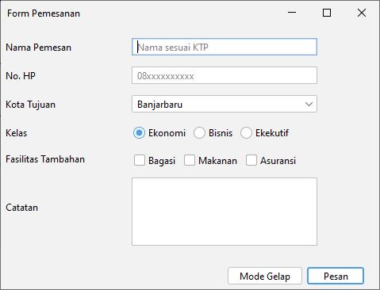

**Tema gelap**

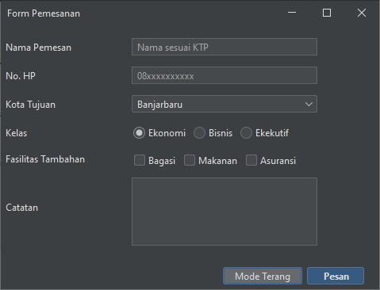

### Tampilan tab Design (jendela Navigator)

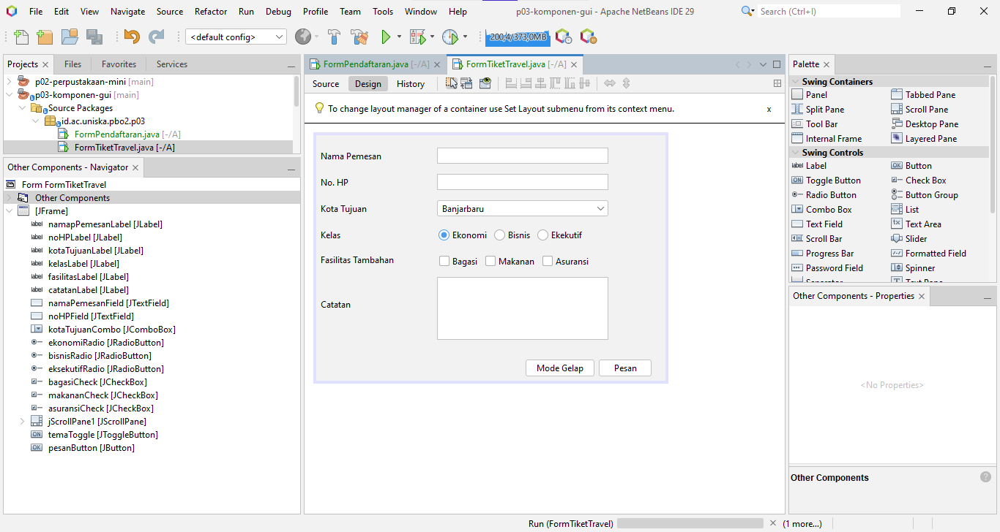

### Refleksi

1. isian kembali pada normal sizenya, saat dilebarkan dia hanya berada di center dan tidak ikut melebar menyesuaikan lebaran jendela windows.

2. isiannya jadi berantakan, seharusnya saat ditinggikan hanya bagian bawah yang kosong tetapi karna dirubah menjadi center label dan isian menjadi ikut ketarik saat ditinggikan.

3. bagian isiPanel yang didalamnya ada formPanel akan rusak terlebih dahulu. Selanjutnya bagian tombolPanel.


## P04 - Layout Manager dan Desain Form

### Sketsa
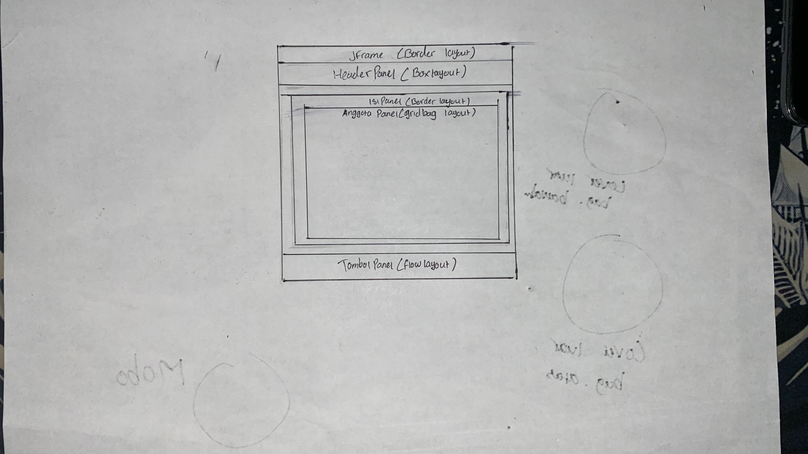


### Tabel Rancangan

| Bagian | Panel | Layout |
|---|---|---|
| Jendela | JFrame | BorderLayout |
| Header (North) | headerPanel | BoxLayout |
| Pembungkus (Center) | isiPanel | BorderLayout |
| Isi form (North di isiPanel) | anggotaPanel | GridBagLayout |
| Jenis anggota (di dalam anggotaPanel) | radioPanel | FlowLayout |
| Tombol (South) | tombolPanel | FlowLayout |


### Tangkapan Layar
**Ukuran awal** 

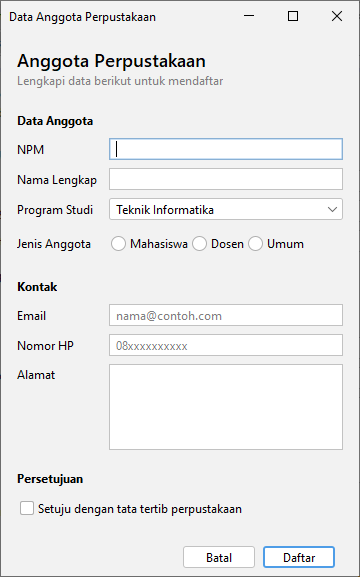

**Saat dilebarkan**

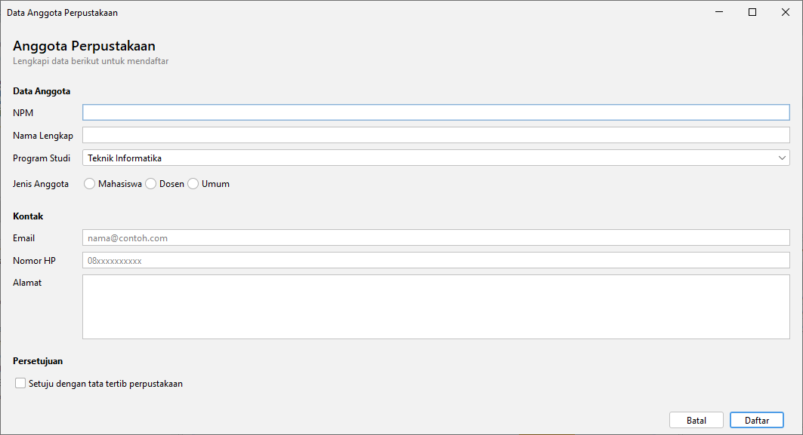

**Tab Design dan Navigator**

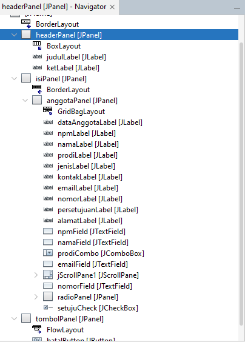

### Eksperimen 1
1. Buttonnya akan berpindah tempat menjadi ketengah saat dikecilkan buttonnya tetap akan mengambil posisi tengah pada panel. baris yang berubah ada pada flowpanel.setLayout()
  flowPanel.setLayout(new java.awt.FlowLayout(java.awt.FlowLayout.CENTER, 8, 8)); (sesudah dirubah)
  flowPanel.setLayout(new java.awt.FlowLayout(java.awt.FlowLayout.LEFT, 8, 8)); (sebelum dirubah)

2. ada 2 baris yang terbentuk karna kita mengubah columnsnya jadi 2. columns = baris 

3.  lebar tombol berubah mengikuti border JFrame jadi dia melebarkan dirinya selebar ukuran JFrame. Vertical Strut menambahkan gap/jarak diantara tombol tombol pada boxPanel.

### Eksperimen 2
1. isian kembali pada normal sizenya, saat dilebarkan dia hanya berada di center dan tidak ikut melebar menyesuaikan lebaran jendela windows.

2. isiannya jadi berantakan, seharusnya saat ditinggikan hanya bagian bawah yang kosong tetapi karna dirubah menjadi center label dan isian menjadi ikut ketarik saat ditinggikan.

3. bagian isiPanel yang didalamnya ada formPanel akan rusak terlebih dahulu. Selanjutnya bagian tombolPanel.

### Saling Menilai

| No | Pemeriksaan | Ya atau Belum |
|---|---|---|
| 1 | Label singkat, jelas, dan sejajar | Ya |
| 2 | Isian dikelompokkan dengan judul bagian | Ya |
| 3 | Placeholder dipakai untuk isian yang punya format | Ya |
| 4 | Komponen sesuai jenis data | Ya |
| 5 | Tombol utama menonjol dan berada di kanan bawah | Ya |
| 6 | Jarak antar komponen konsisten | Ya |
| 7 | Form tetap rapi saat jendela dilebarkan dan ditinggikan | Ya |
| 8 | Tampilan dibuat dengan JFrame Form dan layout manager, bukan Null Layout atau Absolute Layout | Ya |

### Saran Perbaikan
1. Nama komponen `jScrollPane1` masih bawaan NetBeans.


## Deklarasi Penggunaan AI
Saya menggunakan AI untuk membantu memahami modul lebih mendalam agar tidak ada kesalahan dalam pengumpulan penugasan kedepannya. Serta membantu dalam penulisan README.md

## P05 - Event Handling
 
### Peta Event
 
| Komponen | Menu Events | Aksi |
|---|---|---|
| setujuCheck | Item: itemStateChanged | Tombol Daftar hanya aktif jika dicentang |
| batalButton | Action: actionPerformed | Kosongkan semua isian dan kembalikan fokus ke NPM |
| daftarButton | Action: actionPerformed | Tampilkan ringkasan data dengan JOptionPane |
| npmField | Key: keyReleased | Label kecil menampilkan jumlah digit, misalnya "8 dari 10 digit" |
| Form (JFrame di Navigator) | Window: windowClosing | Minta konfirmasi sebelum aplikasi ditutup |
 
Jenis anggota (radio button) dan program studi (combo box) tidak memiliki event sendiri. Nilainya dibaca langsung di dalam event handler tombol Daftar.
 
### Tangkapan Layar
**Jendela Properties bagian Events untuk tombol Daftar**
 
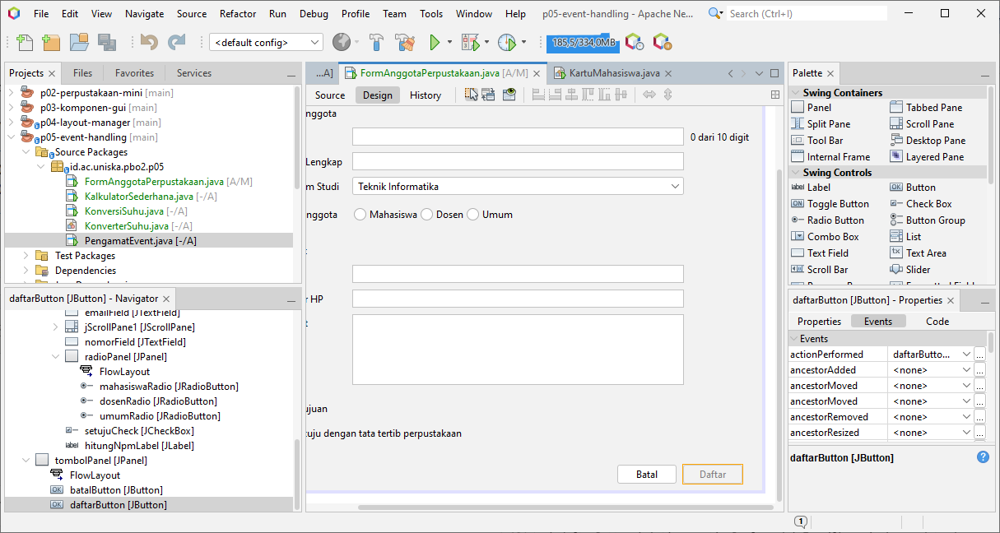
 
**Dialog ringkasan**
 
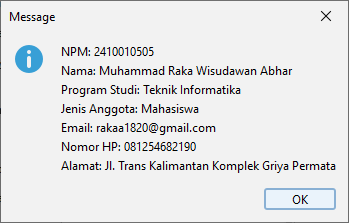
 
**Dialog konfirmasi keluar**
 
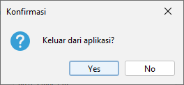
 
### Tabel Pengamatan
 
| No | Tindakan | Event yang tercatat |
|---|---|---|
| 1 | Arahkan kursor ke tombol, lalu jauhkan | Kursor masuk ke tombol, kursor keluar dari tombol |
| 2 | Klik tombol Klik saya | Tombol diklik |
| 3 | Centang lalu hapus centang Aktifkan fitur | Kotak dicentang, centang dihapus |
| 4 | Ganti pilihan dari Pagi menjadi Malam | Memilih Malam |
| 5 | Klik isian, lalu ketik kata "abc" | Isian mendapat fokus, mengetik huruf a, mengetik huruf b, mengetik huruf c |
| 6 | Klik tombol setelah mengetik di isian | Isian kehilangan fokus, tombol diklik |
 
### Eksperimen Praktikum 3
1. Pesan tercetak 2 kali setiap pilihan diganti.
2. Karena saat keyPressed terpicu, karakter yang baru diketik belum masuk ke isian, sehingga getText() membaca teks yang lama. Saat angka 3 diketik, event keyPressed memproses isian yang masih kosong, sehingga hasilnya terlambat satu karakter.
3. Di jendela Output muncul `Exception in thread "AWT-EventQueue-0" java.lang.NumberFormatException: For input string: "a"`.
### Eksperimen Praktikum 4
1. Pesan tercetak dua kali. Sebaiknya satu tombol memakai satu cara saja, karena jika memakai dua cara maka hitung('x') akan berjalan dua kali.
2. Perubahan di tab Design: tombol `%` ditambahkan ke operatorPanel dengan teks `%` dan nama variabel `modulus`. Karena sebelumnya Grid Layout hanya memiliki 4 kolom, jumlah kolom ditambah menjadi 5.
   Perubahan di tab Source: event handler tombol dibuat melalui GUI Builder (Events, Action, actionPerformed), lalu di method `hitung` ditambahkan case baru beserta rumus modulus.
3. Karena di method `hapus` terdapat `requestFocusInWindow()` untuk angka1Field. Jadi setelah tombol Hapus ditekan dan baris-baris sebelumnya dijalankan, fokus kembali ke angka1Field.
### Deklarasi Penggunaan AI
Saya menggunakan AI untuk membantu memahami modul lebih mendalam agar tidak ada kesalahan dalam pengumpulan penugasan kedepannya. Serta membantu dalam penulisan README.md

## P06 - Validasi Input dan Kegunaan

### Lembar Peer Review

Lembar peer review yang saya terima dari teman (peninjau: Muhammad Aidanoor).

[Scan lembar peer review (PDF)](/img/scanPeerReview_p06.jpg)

### Temuan Teman dan Perbaikan

Semua heuristik pada lembar bernilai 0 atau 1. Tidak ada temuan skor 3 (mayor) atau 4 (kritis). Temuan bernilai 1 tetap saya perbaiki.

| No | Heuristik | Temuan dari teman | Skor | Perbaikan yang saya lakukan | Commit |
|---|---|---|---|---|---|
| 1 | Visibilitas status sistem | Tombol Daftar nonaktif tanpa keterangan | 1 | Mengisi toolTipText pada tombol Daftar | 111094c |
| 6 | Mengenali, bukan mengingat | Aturan nomor HP baru terlihat setelah salah mengisi | 1 | Mengisi toolTipText pada nomorField | c9f1960 |

Heuristik no. 2, 3, 4, 5, 7, 8, 9, dan 10 bernilai 0, jadi tidak ada perbaikan.

### Tangkapan Layar

**Form dengan pesan kesalahan**

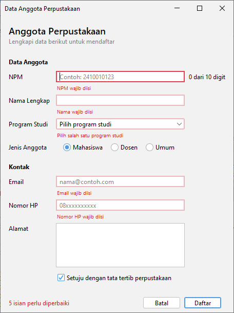

**Jendela Navigator yang memperlihatkan label pesan**

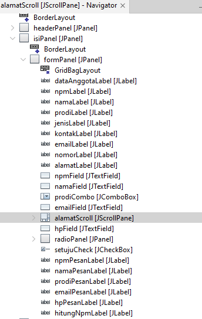

### Eksperimen Praktikum 4

1. Tidak bisa diketik meggunakan huruf. baris yang menyebabkannya if (!Character.isDigit(evt.getKeyChar()) || penuh) {
            evt.consume();
2. Setelah menekan tab
3. Karna tidak field belum diisi apapun jadi kode untuk mengeceknya belum jalan
4. isian NPM karna itu kesalahan paling awal
5. isian nama yang kena focus. Properti Mnemonic yang menganturnya
6. tetap ada karna kode kosongkan() tidak jalan saat kita memilih No

### Deklarasi Penggunaan AI
Saya menggunakan AI untuk membantu memahami modul lebih mendalam agar tidak ada kesalahan dalam pengumpulan penugasan kedepannya. Serta membantu dalam penulisan README.md

## P07 - Tabel, Menu, dan Mini Proyek GUI
 
## Bagian 1: p07-tabel-dan-menu
 
### Eksperimen Praktikum 5
 
1. Tidak, tabel tidak langsung berubah. Data sudah masuk ke list tetapi tabel tidak diberi tahu ada baris baru, karena `fireTableRowsInserted` yang memberi tahu tabel untuk menggambar ulang.
2. Yang muncul di dialog konfirmasi adalah Budi Santoso, bukan Ahmad Fauzi. Karena nomor baris tampilan (1) dipakai langsung sebagai nomor baris model, padahal Ahmad Fauzi ada di baris model 2.
3. Jendela utama tidak terkunci dan masih bisa diklik saat dialog terbuka. Kontak yang ditambahkan tidak masuk ke tabel, karena `setVisible(true)` tidak lagi menunggu dialog ditutup sehingga `tampilkan()` langsung mengembalikan `null`.
4. Karena `ubahItem` dan `hapusItem` dinonaktifkan oleh `perbaruiTombol()` saat tidak ada baris yang dipilih. Accelerator pada menu item yang nonaktif tidak bisa dijalankan, sedangkan Ctrl+N tetap bekerja karena `tambahItem` selalu aktif.
5. Baris pada `initComponents()` yang berubah ada di accelerator hapusItem.
```java
   hapusItem.setAccelerator(javax.swing.KeyStroke.getKeyStroke(java.awt.event.KeyEvent.VK_DELETE, 0)); // sesudah diubah
   hapusItem.setAccelerator(javax.swing.KeyStroke.getKeyStroke(java.awt.event.KeyEvent.VK_D, java.awt.event.InputEvent.CTRL_DOWN_MASK)); // sebelum diubah
```
 
6. Muncul error `java.lang.IllegalArgumentException: Cannot set a null TableModel`. Karena `initComponents()` dipanggil di awal konstruktor dan menjalankan `kontakTable.setModel(model)`, saat itu `model` masih `null` karena baru dibuat setelah `initComponents()`.
---
 
## Bagian 2: p07-mini-proyek (Katalog Buku Perpustakaan)
 
### Peta Event
 
| Komponen | Menu Events | Aksi |
|---|---|---|
| tambahButton, tambahItem | Action: actionPerformed | Memanggil tambah() |
| ubahButton, ubahItem | Action: actionPerformed | Memanggil ubah() |
| hapusButton, hapusItem | Action: actionPerformed | Memanggil hapus() |
| cariField | Key: keyReleased | Memanggil saring() |
| bukuTable | Mouse: mouseClicked | Klik dua kali memanggil ubah() |
| keluarItem | Action: actionPerformed | Menutup jendela |
| batalButton | Action: actionPerformed | Menutup dialog tanpa menyimpan |
| simpanButton | Action: actionPerformed | Memanggil simpan() |
 
### Video Demo
 
[Video demo KatalogBuku (maksimal 3 menit)](https://drive.google.com/file/d/19B8dN-bljDWR2MobmAsw65GVTMyoWnYY/view?usp=sharing)
 
### Deklarasi Penggunaan AI
Saya menggunakan AI untuk membantu memahami modul lebih mendalam agar tidak ada kesalahan dalam pengumpulan penugasan kedepannya. Serta membantu dalam penulisan README.md